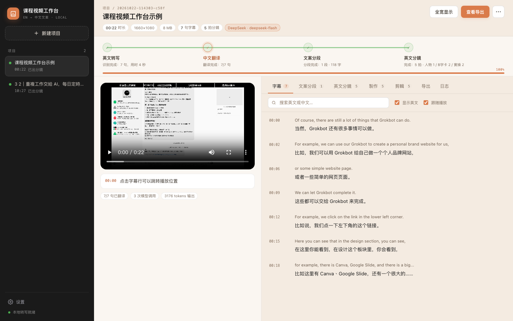
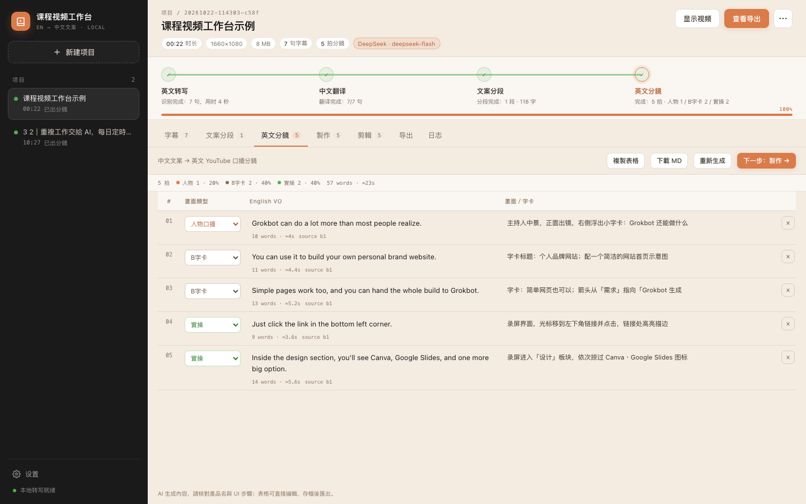
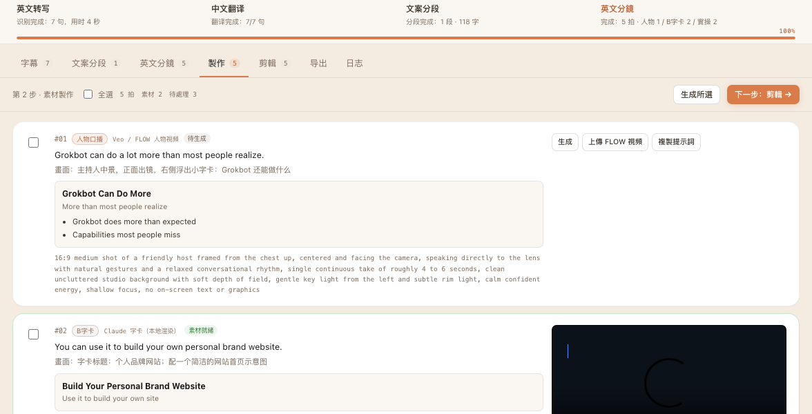
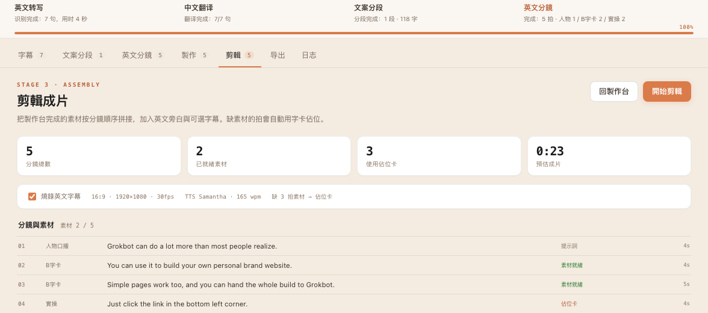
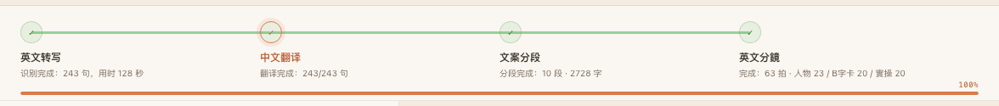
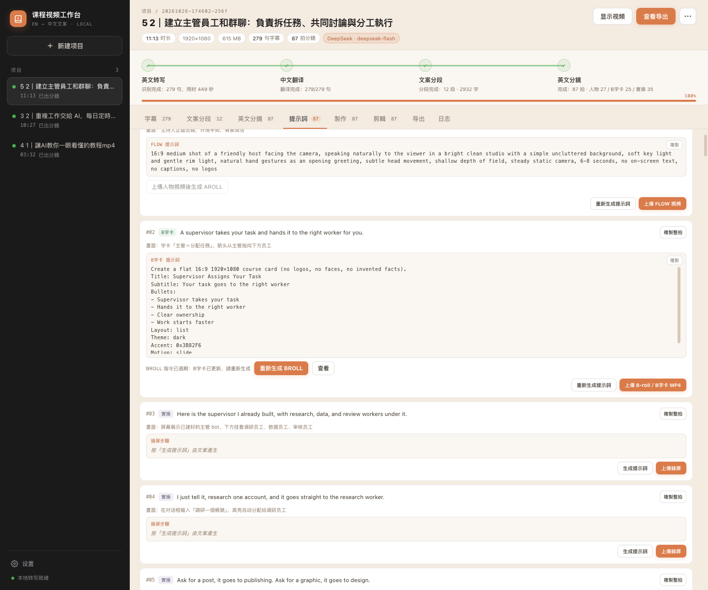
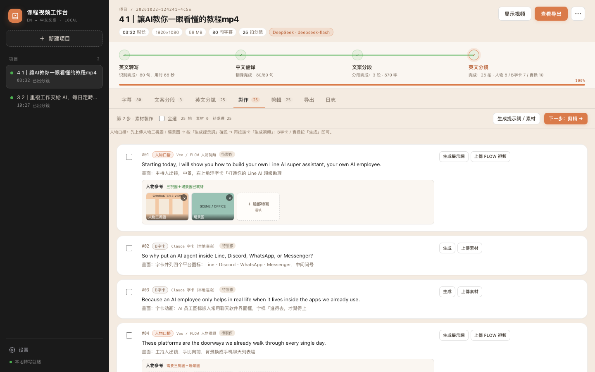
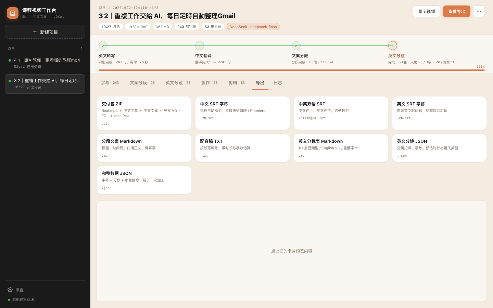

# 课程视频工作台

把英文课程视频变成可直接开拍的中文文案，再按 SKILL 转成英文 YouTube 口播分镜，最后在本地出片：**上传 → 本机转写 → 中文翻译 → 语义分段 → 英文 VO 分镜 → 製作台 → 一鍵剪輯**。

界面以简体中文为主；英文分鏡的畫面類型按 SKILL 使用繁体标签。视频与模型 Key 都留在本机，不上传云端。

> 配色取自 <https://freedumx.io/courses/claude-code>：奶油紙色 `#f4ebe1`、墨黑 `#1a1a1a`、品牌橙 `#da7b4a`、白色卡片與 16px 圓角；側邊欄使用墨黑，主工作區使用奶油紙色。









---

## 现在能做到什么（v0.3）

| 能力 | 说明 |
| --- | --- |
| 上传视频 | mp4 / mov / m4v / mkv / webm / avi，单文件最大 4GB，支持拖拽 |
| 英文转写 | faster-whisper 在本机运行，输出带时间戳的字幕，不需要联网 |
| 中文翻译 | 通过 OpenAI 兼容接口调用 Claude / Grok / DeepSeek / Gemini，逐句翻译并保留时间轴 |
| 文案分段 | 按语义把整节课整理成 45–120 秒的口播段落，带标题、摘要、屏幕字和字数/时长估算 |
| 英文 YouTube 分鏡 | 使用 SKILL「Chinese course to English YouTube VO shots」把中文文案改写成英文口播，每拍一个镜头、≤25 words，画面类型固定为人物口播 / Broll / 實操 |
| 逐句编辑 | 中英对照列表，点时间码跳转视频，修改自动保存 |
| AI 改写 | 对任意段落下指令（更口语、缩短、加钩子、改第二人称），预览后一键替换 |
| 专有名词表 | 修正 ASR 听错的品牌名（如 Grogobot → Grokbot、Masked Class → Masterclass），并在翻译/分段时强制统一 |
| 导出 | 中文 SRT、中英双语 SRT、英文 SRT、文案 Markdown、配音稿 TXT、英文分鏡表 Markdown、分鏡 JSON、完整 JSON |
| 製作台 | 每一拍一张卡：人物口播上傳三視圖＋場景圖後直接按「生成人物視頻」，沒有提示詞時會先用文案自動生成；Broll／實操直接生成；狀態、素材、提示詞都能單獨重做 |
| Broll出片 | Claude 出 VideoSpec，工作台用本机 FFmpeg 渲染 1920×1080 MP4（不是只给提示词） |
| 剪輯頁 | 素材、設定、進度、成片分開顯示；按拍序拼接；缺素材用佔位卡；TTS 英文旁白；字幕可选；輸出 16:9 `final.mp4` |
| 断点续跑 | 转写、翻译、分段、英文分鏡、製作、剪辑分步执行；失败可单独重试，不用从头再来 |

> 9:16 竖版、背景音乐、转场、人物口型驱动属于下一阶段，见文末 [Roadmap](#roadmap)。

---

## 快速开始

### 环境要求

- macOS（Apple Silicon 或 Intel）
- Node.js 20+（本机为 v22）
- Python 3.9+，已安装 `faster-whisper`、`av`、`numpy`

检查 Python 依赖：

```bash
python3 -c "import faster_whisper, av; print('ok')"
```

### 启动

```bash
cd /Users/gold/Desktop/Deepseek/video-workbench
./start.sh
```

然后打开 <http://127.0.0.1:4321>。

macOS 也可以直接双击 **`start.command`**，会自动启动服务并打开浏览器。

首次运行 `start.sh` 会自动 `npm install`。服务只监听 `127.0.0.1`，不会暴露到局域网。

### 固定流程（不需要選 API）

工作台已經鎖定一套流程，**左下角設定不再提供 API／模型選項**；打開只會看到固定流程與字幕開關。

| 階段 | 固定使用 |
|---|---|
| 英文轉寫 | 本機 `faster-whisper medium` |
| 中文翻譯 | DeepSeek Flash |
| 文案分段 | DeepSeek Flash |
| AI 改寫 | DeepSeek Flash |
| 英文分鏡 | 內建 SKILL + DeepSeek Flash |
| 製作方案 VideoSpec | DeepSeek Flash |
| A-roll 指示詞 | DeepSeek Flash |
| 人物視頻 | Flow 手動生成 → 上傳 MP4 |
| Broll / 剪輯 / 旁白 | 本機 FFmpeg + macOS Samantha |

- 不需要在介面填 Claude / Gemini / xAI Key
- DeepSeek Key 已保存在本機 `data/settings.json`（權限 600）
- 要改模型或 API，請找開發者改設定檔，不在 UI 開放
- 人物口播用 Flow 手動；工作台只負責出提示詞、收 MP4、剪輯

如果 DeepSeek 需要代理，在 `.env` 或啟動前設定：

```bash
export HTTPS_PROXY=http://127.0.0.1:7892
```

> 目前啟動時會先探測代理；代理不通就改直連。DeepSeek 直連可用，Claude / Google 直連在中國通常不可用。

---

## A-roll 指示詞生成器

工作台已內建 `skills/aroll-motion-prompts/SKILL.md`（彩色 SaaS 卡片風），由一拍的 English VO 直接產出 **Markdown 指示詞**，貼給 Opus 5.5 就能製作影片。

- **人物口播卡**：`生成 A-roll 指示詞` / `重新生成指示詞` / `複製指示詞` / `下載指示詞`（`.md`）
- 生成器會讀這一拍的 VO、visual、秒數（有 Base 影片就用實際時長），產出：
  - 使用方法、素材表、鏡頭總表
  - 第 0 部分：模板 0 共用風格說明（配色、組件、A1–A4 版式、動效詞典、轉場）
  - 每個鏡頭一個代碼塊（座標、字號、顏色、秒數全部寫死）
  - 最後的拼接步驟
  - 「需要實測後填寫」清單

工作台裡沒有 ffprobe / whisper / 瀏覽器截圖這些工具，所以：

- 人臉平移量先寫成佔位符 `{A2_LEFT}` / `{A4_LEFT}` / `{A4_TOP}` / `{A3_LEFT}`，連同量法一起列在文件末尾
- 時間軸按 VO 與實際 Base 時長自行排布，不是 Whisper 逐詞對齊；文件會標出秒數與實際檔長不一致的地方

Opus 5.5 那一步仍然輸出 Pillow 腳本在本機合成；指示詞裡描述的 HTML/Playwright 做法會要求 Opus 換算成 Pillow 繪圖。

舊的 **B-roll / plate XML 路徑已不再從介面產生**（分鏡只剩 人物口播 + 實操）。`上傳 XML` 仍保留，用來手掛舊 plate。

---

## 啟動與常駐

- 平常：雙擊 `start.command`，Terminal 要開著。
- 想背景常駐：雙擊 `start-background.command`，它會用 detached process 啟動，不佔 Terminal，並自動開瀏覽器。
- 若 `http://127.0.0.1:4321/` 打不開，先看 `data/server.log` 最後幾行，再重新啟動。

---

## 規則包（保留，不再參與 A-roll 生成）

```text
skills/aroll-motion-prompts/SKILL.md      ← A-roll 指示詞（現行，彩色 SaaS 卡片風）
skills/aroll-rules/                       ← 舊 MODS XML 規則、examples、USED-MIE
skills/broll-rules/                       ← 舊 B-roll 規則、examples、USED-MIE
skills/tristen-b-roll-motion-prompts/     ← 舊 B-roll 調色 / icon / end code
```

A-roll 生成現在只載入 `aroll-motion-prompts/SKILL.md`；`aroll-rules` 與 `broll-rules` 不再參與生成，留著是為了舊 plate XML 的脈絡與回溯。
- `logs/USED-MIE.txt` 的已用碼

M/I/E 與 plate 會從全域 log 接續，不再從 plate-131 重來。  
目前測到 **plate-178 / M532–534 / I531–533 / E180**；下一次會接 plate-179。

BROLL 會以 Broll prompt 為固定設計來源，不會再自己發明 violet 舞台。

---

## 使用流程（精簡版）

1. **上传**：拖入视频。上传完成后会自动开始转写；如果翻译模型已配置，会接着翻译、分段，并在设置开启「自动生成」时继续生成英文分鏡。
2. **检查字幕**：「字幕」页对照英文和中文，直接改错译；点左侧时间码跳转视频。
3. **生成分段**：「文案分段」页查看每段标题、口播文案、屏幕字；可以逐段 AI 改写。
4. **英文分鏡**：「英文分鏡」页查看每一拍的畫面類型 / English VO / 畫面字卡；表格可直接改，保存后导出 Markdown。
5. **提示詞**：英文分鏡後直接進「提示詞」頁。
   - **人物口播**：先做無動效 Base 視頻（Flow 或模型）→ 上傳 Base → 自動出 AROLL XML → 連同 Base 交給 Opus 5.5
   - **Broll**：直接從 English VO 出 BROLL XML，不需要先做字卡 prompt
   - **實操**：不需要提示詞，直接上傳錄屏
6. **Opus 5.5**：工作台只出 XML 和交接包；Opus 5.5 做好後，把最終視頻上傳回同一張卡。
7. **剪輯 / 導出**：到剪輯頁合成，導出交付包。

失败时页面顶部会出现原因和「重试」。右上角 `⋯` 菜单可以单独重跑转写、翻译、分段或英文分鏡。

> 英文分鏡、文案分段、製作、導出預設 **全寬**，不顯示左側視頻，避免卡片被擠在右邊；點右上角「顯示視頻」可切回左側預覽。字幕頁仍保留分屏。

> 頂部四步進度軌是全寬的：綠線代表已完成、橙點代表目前頁面；點英文轉寫／中文翻譯會跳到字幕，點文案分段跳到文案，點英文分鏡跳到分鏡。底部另有一條整體進度條與百分比。



### 字幕页快捷键

- `⌘K` / `Ctrl+K`：聚焦搜索
- 点时间码：跳转并播放
- 勾选「跟随播放」：字幕自动滚动到当前句

### 专有名词表

设置 → 文案偏好 → 专有名词表，一行一条：

```
Grokbot = Grogobot, Grok Bot, Grok bot
Mobbin = Mobin
Masterclass = Masked Class, Master Class
Ethan = Eason, Isen
```

等号右边是 ASR 常见的错误写法，逗号分隔。转写完成后会先做一次替换，翻译和分段的提示词里也会带上正确写法。

### 英文 YouTube 分鏡 SKILL

安装在 [skills/chinese-course-to-english-youtube-vo-shots/SKILL.md](skills/chinese-course-to-english-youtube-vo-shots/SKILL.md)，来源是你提供的
`chinese-course-to-english-youtube-vo-shots.tar.gz`。生成时会把整份 SKILL 作为系统提示词，并对输出做程序校验：

- 每个 beat 只对应一个镜头，英文 VO ≤25 words（超过会先让模型修正，仍超长会按句子/逗号拆拍并标记）
- 畫面類型只允许 `人物口播` / `Broll` / `實操`
- 默认配比：人物口播 30–35%、Broll 25–30%、實操 35–40%（可切「无露脸」模式）
- 不允许中文混进口播；不允许用连字符/破折号当停顿
- 输出固定为 Markdown 表格：`| # | 畫面類型 | English VO | 畫面/字卡 |`
- 同时在任务目录保留 `english/zh-source.txt`、`english/en-vo-shots-table.md`、`english/en-vo-shots.json`

设置 → **英文 YouTube 分鏡** 可以控制自动生成、镜头模式和补充要求。

---

## 提示詞頁（只出提示詞）

英文分鏡完成後，按 **下一步：提示詞 →**，不用先進製作台。

提示詞頁只輸出：

- **人物口播**：`FLOW 提示詞` + `AROLL 指令`（AROLL 需先上傳人物視頻）
- **Broll / BROLL**：直接輸出 `BROLL 指令（XML）`，格式和 `plate-178...broll.xml` 範例相同
- **實操**：`錄屏步驟`

它**不會**呼叫影片 API，也不會自動生成 MP4。

每張提示詞卡也保留上傳：

- 人物口播 → **上傳 FLOW 視頻**
- Broll → **上傳 B-roll／Broll MP4**
- 實操 → **上傳錄屏**

你做完 Flow / Broll / 錄屏後，可以直接在提示詞頁上傳，不必先回製作台；上傳後會顯示「視頻已上傳」與「預覽」。

人物口播上傳完成後會自動生成 AROLL 指令（使用上傳片的 duration 與這一拍 VO），生成結果會出現在提示詞卡和剪輯頁的「剪輯指令」。



### 操作

1. 按 **生成缺少的提示詞**：只補還沒有 prompt 的分鏡
2. 每張卡可以 **複製整拍**、單獨複製 prompt、或 **重新生成提示詞**
3. **AROLL 指令需要先上傳人物視頻**：人物口播上傳 Flow 視頻後，工作台會**自動**呼叫 AROLL SKILL 生成指令；如果自動失敗，卡片上的按鈕可以手動重試。BROLL 不需要視頻
4. 每張已有 XML 的卡可以按 **下載 XML**（例如 `plate-179-one-manager-clear-work-broll.xml`）
5. 按 **導出全部提示詞** 下載 Markdown，內含每一拍的 VO、畫面、FLOW prompt、AROLL／BROLL XML

### 輸出格式

```text
# 課程標題 · 提示詞

## #01 人物口播
- English VO：...
- 畫面：...

### FLOW 提示詞
16:9 medium shot ...

### AROLL 指令
<role>...</role>
```

Broll則是直接給 XML：

```xml
<role>… Plate 179 — NEW this cut: M535 + M536 + M537 …</role>
<source>…</source>
<script_timed>…</script_timed>
<stitch>…</stitch>
<style_lock>…</style_lock>
<icons>…</icons>
<end>… E181 …</end>
<edit>…</edit>
<banned>…</banned>
<self_check>…</self_check>
<deliver>…</deliver>
```

> Broll就是 BROLL：BROLL 指令會讀 Broll prompt（title / subtitle / bullets / layout / theme / accent），動畫化同一張卡，不會再自己發明 violet stage。

> 提示詞是拿去做 Claude / Flow / Canva 的輸入，不是最終影片。人物影片仍走 Flow 手動生成後上傳。

---

## 製作台 → 剪輯頁

進入「英文分鏡」页后，点右上角 **下一步：製作 →**。

### 分流规则

| 畫面類型 | 預設路線 | 工作台動作 |
| --- | --- | --- |
| 人物口播 | Google Omni / Veo API | 上傳**人物三視圖＋場景圖**後，按「生成人物視頻」直接呼叫 Omni/Veo；沒有提示詞時會先用文案生成，沒有 Key 就上傳 FLOW |
| Broll / B-roll | Claude + 本机 FFmpeg | Claude 出 VideoSpec（标题/副标/要点/版式/动效），FFmpeg 渲染成 MP4 |
| 實操 | 录屏 | Claude 出可执行的点击/输入步骤，等你上传录屏；缺录屏时先用佔位卡 |

- 每张卡可以单独「生成 / 重新生成 / 上传素材 / 複製提示词 / 下载」。
- 全选后批量生成；状态会实时更新。
- 「人物口播」上传 FLOW/Veo 生成的视频后，会自动替换佔位卡；导出前建议到剪輯页重新「一鍵剪輯」。

### 人物參考圖（三視圖 + 場景圖）

人物口播卡上會有三個參考圖位：

| 欄位 | 必填 | 用途 |
| --- | --- | --- |
| 人物三視圖 | ✅ | 正面／側面／背面，固定臉、髮型、身形、服裝 |
| 場景圖 | ✅ | 房間、家具、燈光、攝影機方向 |
| 臉部特寫 | 選填 | 額外的 identity 參考 |

- 支援 PNG / JPG / WEBP，存在 `data/jobs/<id>/production/refs/`
- **VIDEO PROMPT 是可編輯 textarea**：可以直接改寫、自己寫，按「保存提示詞」後再生成；AI 生成只是可選
- 人物口播卡不顯示 VideoSpec 字卡草案（那只是 AI 的內容摘要，不會進入影片）；Broll才用 VideoSpec 渲染
- 兩張必填圖都上傳後，「生成人物視頻」才會啟用；沒有手寫提示詞時會自動用文案生成
- 生成時會把參考圖傳給 **Gemini Omni**（`reference_to_video`）或 **Veo**（最多 3 張 referenceImages），並在 prompt 加上「same character / same room / same lighting」的約束
- 沒有參考圖時，仍可以「上傳 FLOW 視頻」手動補素材

> Google Flow 本身沒有官方 API；這裡的影片 API 是它背後的 Omni/Veo。你要在 Flow 網頁手動生成也可以，生成後把 MP4 上傳回同一張卡。



### 成片

- 固定 **16:9 / 1920×1080 / 30fps**，H.264 + AAC。
- 每个 beat 用 **macOS `say`** 生成英文 TTS 旁白（默认 Samantha，可在设置改 voice/rate）。
- 素材按拍序拼接；人物口播视频会静音并使用统一 TTS，避免不同 FLOW 片段的音色不一致。
- 字幕可选：设置或剪輯页勾选「燒錄字幕」；字幕内容是 English VO。
- 输出 `data/jobs/<id>/production/final.mp4`，在剪輯页直接预览或下载。

> Claude 本身只出文字/代码，不会直接吐 MP4；这里的「Claude 產出影片」是 Claude 出 VideoSpec，工作台用 FFmpeg 渲染。Veo 是真正的文生视频 API；没有 Key 时人物口播会降级为提示词 + 上传。

### Google Veo 设置

设置 → 製作與成片：

- 填 **Google Gemini API Key**（Omni / Veo 共用）
- 模型默认 `gemini-omni-1.1-flash`（Omni Flash，Interactions API）
- 也可以改回 `veo-3.1-fast-generate-preview`，但 Veo 3.1 Preview 已于 2026-10-22 关闭，不建議
- API 地址默认 `https://generativelanguage.googleapis.com/v1beta`
- 单拍时长默认 8 秒
- API Key 只保存在本机 `data/settings.json`

> Omni Flash 走 `POST /v1beta/interactions`，回傳 base64 / URI 影片；Veo 走 `predictLongRunning`，两者 adapter 不同。没有 Key 时，製作台不会假装生成人物视频。

---

## 交付包 ZIP（影片＋文案）

成片完成後，導出頁第一張卡就是 **交付包 ZIP**；按一下會下載一個完整交付資料夾。



```text
<專案>/
  README.md
  manifest.json
  checksums.txt
  video/
    final.mp4
    cover.jpg
  subtitles/
    zh.srt
    en.srt
    bilingual.srt
  copy/
    zh-copy.md
    en-vo.md
    en-vo.csv
    bilingual-timeline.csv
  edit/
    shot-list.csv
    timeline.json
  publish/
    chapters.txt
    youtube-description.md
  source/
    transcript.json
    production.json
    job.json
```

- `video/final.mp4`：完成影片
- `subtitles/`：中文、英文、中英雙語字幕
- `copy/zh-copy.md`：完整中文分段文案
- `copy/en-vo.md` / `en-vo.csv`：英文口播分鏡
- `copy/bilingual-timeline.csv`：逐拍英文 VO、對應中文、時間碼、畫面
- `edit/shot-list.csv` / `timeline.json`：beat_id、素材、route、時間軸
- `publish/`：章節與 YouTube 描述草稿
- `manifest.json`：檔案清單、SHA256、模型與統計
- `checksums.txt`：整包完整性校驗

> `bilingual-timeline.csv` 的中文是依時間／段落比例對應到 beat，屬於近似對齊；完整逐段中文在 `copy/zh-copy.md`。

---

## 剪輯頁

製作台只負責「補素材」；剪輯是獨立一頁，避免卡片和成片擠在一起。

進入方式：製作台右上角 **下一步：剪輯 →**。

剪輯頁只放四塊：

1. **成片統計**：分鏡數、已就緒素材、使用佔位卡數量、預估時長
2. **成片設定**：是否燒錄英文字幕、16:9 / 1920×1080 / 30fps、TTS 旁白與語速、缺素材提示
3. **渲染進度**：開始剪輯後顯示進度條與當前步驟
4. **成片與分鏡清單**：成片折疊條（展開才播視頻）；下面是緊湊的 63 行分鏡/素材對照表，不再用大卡片

頁面預設全寬，影片欄隱藏；點右上「顯示視頻」可切回分屏。剪輯頁的「回製作台」可以直接回去補 FLOW/Veo 素材或 Broll。

> 剪輯是整片渲染，不是只剪勾選的拍；缺素材的拍會自動用字卡佔位，所以可以先出 draft，再回頭補素材重剪。

---

## 技术结构

```
video-workbench/
├── server/                 Node 后端（Express）
│   ├── index.mjs           API、上传、视频流（Range）、导出
│   ├── pipeline.mjs        转写 / 翻译 / 分段 / 英文分鏡编排
│   ├── llm.mjs             OpenAI 兼容客户端（重试、JSON 提取）
│   ├── prompts.mjs         翻译、分段、改写提示词
│   ├── english.mjs         英文 YouTube VO 分鏡（读 SKILL.md、校验、表格）
│   ├── production.mjs      製作台：VideoSpec、Veo、素材与成片编排
│   ├── video.mjs           FFmpeg 字卡/片段/TTS/拼接/字幕
│   ├── veo.mjs             Google Veo / Gemini API 适配
│   ├── glossary.mjs        专有名词修正
│   ├── exports.mjs         SRT / 文案 / 配音稿生成
│   ├── jobs.mjs            任务与文件存储
│   └── config.mjs          设置、服务商预设
├── worker/
│   ├── transcribe.py       faster-whisper 转写，JSONL 进度
│   └── probe.py            用 PyAV 读时长/分辨率/音轨
├── skills/
│   └── chinese-course-to-english-youtube-vo-shots/SKILL.md
├── public/                 无构建前端的单页界面
├── data/                   （gitignore）任务、视频、导出、Key、production/
├── docs/                   截图
├── start.sh                启动脚本
├── start.command           macOS 双击启动
└── .env.example
```

**数据流**

```
视频 ──PyAV 解码──► 16kHz 单声道 ──faster-whisper──► 英文句级时间戳
     ──LLM 分批翻译（并发 4）──► 中文逐句字幕
     ──LLM 语义分段──► 标题 / 口播文案 / 屏幕字 / 时长估算
     ──SKILL + LLM──► 英文 YouTube VO 分鏡（画面类型 / English VO / 畫面字卡）
     ──製作台──► Claude VideoSpec + FFmpeg 字卡 / Veo 人物视频 / 录屏
     ──一鍵剪輯──► TTS + 拼接 + 可选字幕 ──► final.mp4
     ──► SRT / Markdown / 配音稿 / 分鏡表 / 成片
```

**为什么不用 FFmpeg**：转写只需要音轨，PyAV 直接解码，省掉安装 FFmpeg 的步骤。后续要做字幕烧录、拼接、转场时再加 FFmpeg。

**长视频处理**：翻译按约 40 句一批并发请求，分段按约 1.1 万字一批，英文分鏡按约 4800 字一批；单批失败会重试并保留已完成的部分。

---

## 数据与隐私

- 视频、字幕、文案、Key 全部在 `data/`，不上传云端。
- 发给模型服务商的只有**字幕文本**，不包含视频画面。
- 删除项目会删除对应 `data/jobs/<id>/` 整个目录。
- 清空所有数据：停止服务后删除 `data/` 即可（会连 Key 一起删掉）。
- `data/settings.json` 已设置 `chmod 600`；不要把它提交到 Git 或打包分享。

---

## 常见问题

**Q：转写很慢？**
默认 `medium`，在 M 系列 Mac 上比 small 慢一些但准确率明显更好；20 分钟视频大约 5–10 分钟。设置里可换 `large-v3` 再提升准确率，但首次需要下载模型（写入 `data/models`），速度更慢。

**Q：翻译报 401 / invalid key？**
Key 失效或复制不完整。到设置里重新粘贴并点「测试连接」。AIHubMix 的 `/models` 即使 Key 无效也可能返回列表，所以一定要看聊天测试是否成功。

**Q：翻译到一半失败？**
已完成的句子会保留。修好 Key 后点「继续翻译」，或右上角菜单重跑翻译。

**Q：字号太小 / 字幕太长？**
导出断行默认 20 字。可以在 `data/settings.json` 的 `export.maxLineChars` 调整，重启服务生效。

**Q：能直接烧录字幕进视频吗？**
可以。剪輯页勾选「燒錄字幕」，一鍵剪輯會把 English VO 烧进成片；不勾就输出无字幕版。

**Q：英文分鏡出现产品名/UI 细节错误？**
先检查「文案分段」里的中文是否已经错了（本工作台的英文分鏡严格以中文文案为事实源）。可以直接在分鏡表格里改，或修正中文文案后点「重新生成英文分鏡」。AI 生成后建议人工核对一遍产品名与操作步骤。

**Q：英文分鏡超过 25 words 怎么办？**
生成时会自动重试并拆分；如果手动编辑后超过 25 words，行会标红但不强制改写，方便你保留原句后自己处理。

**Q：Claude 真的能生成影片吗？**
Claude API 只出文字/代码。工作台让 Claude 出 `VideoSpec`（画面文字、版式、动效），再由本机 FFmpeg 渲染成 MP4；所以 Broll/B-roll 字卡是真视频。真实人物/实拍镜头要 Veo API 或上传 FLOW 片段。

**Q：Veo / Omni 报模型不存在 / 401？**
确认 Key 有 Gemini API 的影片权限；Omni 用 `gemini-omni-1.1-flash`，Veo 用 `veo-3.1-*-generate-preview`（已关）。预览版接口变动频繁，必要时把错误贴给我，我按实际返回结构改 `server/veo.mjs`。

**Q：成片里人物口播和 TTS 对不上？**
目前统一用 TTS 旁白，Veo/FLOW 画面会静音；嘴型只能做到大致同步。要严格对口型，需要改用支持 TTS 驱动的数字人 API（HeyGen 等），或保留 FLOW 原声并接受音色不统一。

**Q：一鍵剪輯很慢？**
每拍要渲染字卡/片段、生成 TTS、拼接、可选字幕烧录；16 拍大约几分钟。素材越多、字幕开启越慢。

**Q：FLOW 为什么还要手动？**
Google Flow 是一个网页产品，没有公开的稳定 API；本工作台接的是 **Google Veo / Gemini API**。如果你的账号只能用 Flow 网页版，就继续用「生成提示词 + 上传成片」；如果你有 FLOW 或其他视频工具的 API 文档，发我，我按实际接口接。

---

## Roadmap

按你描述的完整工作台，后续可以接：

1. **人物视频**：Veo 适配已经接好；下一步补角色一致性、参考图、口型驱动，以及 Kling / Runway / HeyGen 适配。
2. **FLOW 半自动**：每段生成可直接粘贴的 Flow / Veo 提示词与参考图包，结果回传归档；有 API 后再全自动。
3. **自动剪辑**：已能拼接 + TTS + 可选字幕；下一步加转场、片头片尾、背景音乐 ducking、9:16 竖版。
4. **TTS 配音**：按段落生成中文配音，自动对齐时间轴，导出带配音的成片。
5. **批处理**：整个课程文件夹排队转写，统一术语表和品牌风格。

当前的 `server/pipeline.mjs` 已经把「任务 / 步骤 / 模型 / 进度 / 导出」拆开，新增步骤（如 `storyboard`、`voice`、`render`）可以沿用同一套状态机和界面。

---

## 已验证

- 21 分钟英文课程原片的音轨/元数据探测；200 秒片段完整转写（faster-whisper small）
- 79 句字幕 → 中文翻译 79/79 → 3 段文案 → 6 种导出
- 95 秒片段完整四步：34 句字幕 → 34/34 翻译 → 2 段文案 → 16 拍英文分鏡（最长 17 words，人物 4 / Broll 4 / 實操 8）
- 26 秒片段製作台：6 拍 → 1 个 Broll MP4 + 2 个 Veo 提示词 + 3 个录屏脚本 → 一鍵剪輯 32.8 秒成片（TTS + 可选英文字幕）
- 63 拍真实课程：全占位卡 draft 也能在剪輯页完成 6:04 成片，进度与素材对照表正常
- 无字幕版 / 有字幕版都验证；字幕时间轴按片段时长对齐
- 浏览器完整流程：上传进度、自动转写、自动翻译分段、英文分镜表格编辑与保存、AI 改写、导出预览、设置连接测试
- 无控制台报错，视频 Range 拖动正常

测试环境：macOS 26.5.1 / Apple Silicon / Node 22 / Python 3.9 / faster-whisper 1.2.1 / FFmpeg 6.0（ffmpeg-static）。

> 目前 Claude Opus 5.5 与 Google Gemini Key 还没有配置到 `data/settings.json`，所以製作方案会 fallback DeepSeek，人物口播只能出提示詞／上傳 FLOW；填上 Key 后「生成人物視頻」会直接呼叫 Omni/Veo。
